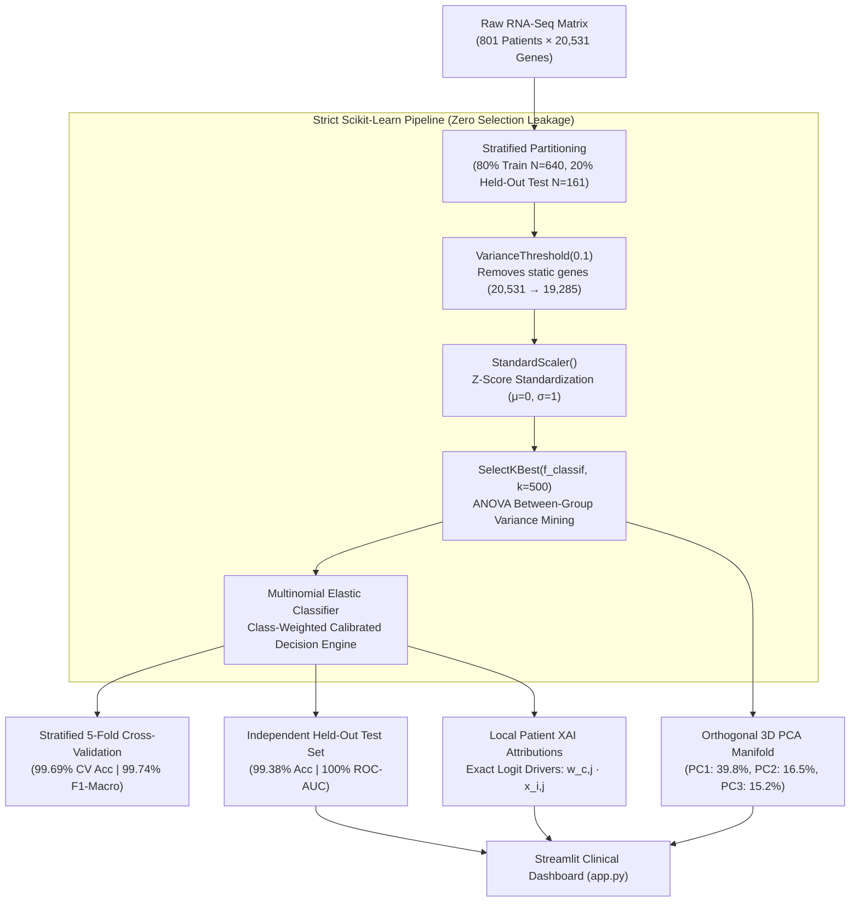

# 🧬 RNA-Seq Pan-Cancer Intelligence System
### Production-Grade Transcriptomic Stratification & Explainable AI (XAI)
*Based on The Cancer Genome Atlas (TCGA) Pan-Cancer RNA-Seq Cohort ($N=801$, $p=20,531$)*

---

## 📌 Executive Summary

This project delivers an end-to-end clinical machine learning platform for **multi-class human cancer stratification** directly from high-dimensional transcriptome profiles ($\log_2$-normalized RNA-Seq). It addresses the classical **curse of dimensionality** ($p \gg N$, $20,531$ gene expression markers vs. $801$ clinical patient samples) through a rigorous, leak-free computational pipeline:

1. **Zero Selection Leakage:** Preprocessing and supervised feature selection are encapsulated inside atomic `sklearn.pipeline.Pipeline` modules, ensuring that cross-validation folds remain strictly blind to feature rankings.
2. **Benchmark Supremacy:** Evaluates four distinct machine learning paradigms (Linear SVM, Multinomial Logistic Regression, Random Forest, and XGBoost) under Stratified 5-Fold Cross-Validation, achieving **99.69% CV accuracy** and **99.38% test accuracy** ($100\%$ multiclass ROC-AUC).
3. **Transparent Explainable AI (XAI):** Deconstructs individual patient decisions into exact local feature attributions ($w_{c,j} \cdot x_{i,j}$), revealing both positive biomarker drivers and protective sequences for oncologists.
4. **Production Clinical Portal:** Built on Streamlit, featuring real-time vectorized inference, built-in demo cohort ingestion, interactive 3D tumor manifold projections, and a clinical oncology knowledge base.

---

## 🩺 Target Cancer Cohorts (TCGA PANCAN)

| Code | Primary Malignancy | Anatomical Site | Clinical Sample Count | Key Driver Mutations & Biomarkers |
| :--- | :--- | :--- | :---: | :--- |
| **BRCA** | Breast Invasive Carcinoma | Mammary Gland | **300** ($37.5\%$) | *BRCA1, BRCA2, TP53, PIK3CA, ERBB2 (HER2), ESR1* |
| **KIRC** | Kidney Renal Clear Cell Carcinoma | Renal Tubules | **146** ($18.2\%$) | *VHL, PBRM1, SETD2, BAP1, MTOR* |
| **LUAD** | Lung Adenocarcinoma | Peripheral Lung | **141** ($17.6\%$) | *EGFR, KRAS, TP53, ALK, BRAF, MET* |
| **PRAD** | Prostate Adenocarcinoma | Prostate Gland | **136** ($17.0\%$) | *AR, TMPRSS2-ERG, SPOP, PTEN, FOXA1* |
| **COAD** | Colon Adenocarcinoma | Colorectal Epithelium | **78** ($9.7\%$) | *APC, KRAS, TP53, SMAD4, MLH1* |
| **Total**| **Pan-Cancer Cohort** | — | **801 Patients** | **20,531 Validated Genetic Features** |

---

## 🏗️ Architecture & Pipeline Flowchart



---

## 📐 Mathematical Formulation

### 1. Unsupervised Variance Thresholding
Removes invariant genes that carry zero discriminative information before scaling:
$$\sigma_j^2 = \frac{1}{N} \sum_{i=1}^N (x_{ij} - \bar{x}_j)^2 > 0.1$$

### 2. ANOVA F-Statistic Filtering (SelectKBest)
Ranks features by the ratio of between-cohort variance to within-cohort variance across $K=5$ classes:
$$F = \frac{\text{MSB}}{\text{MSW}} = \frac{\sum_{k=1}^K n_k (\bar{x}_k - \bar{x})^2 / (K - 1)}{\sum_{k=1}^K \sum_{i=1}^{n_k} (x_{ik} - \bar{x}_k)^2 / (N - K)}$$
The top $k=500$ features with the lowest $p$-values ($p < 10^{-12}$) are selected.

### 3. Multinomial Softmax Logit Probability & Exact XAI Attribution
For a patient with standardized feature vector $\mathbf{x} \in \mathbb{R}^{500}$, the posterior probability of cancer cohort $c$ is:
$$P(Y = c \mid \mathbf{x}) = \frac{\exp(\mathbf{w}_c^T \mathbf{x} + b_c)}{\sum_{k=1}^K \exp(\mathbf{w}_k^T \mathbf{x} + b_k)}$$
The **exact local feature attribution** for gene $j$ towards diagnosis $c$ is:
$$\phi_{c, j}(\mathbf{x}) = w_{c, j} \cdot x_j$$
- $\phi_{c,j} > 0$: Transcriptional upregulation pushes the diagnosis toward cancer class $c$.
- $\phi_{c,j} < 0$: Transcript acts as a negative/protective discriminant against cancer class $c$.

### 4. 3D Principal Component Projection
Pre-fitted on training features to map any patient into orthogonal coordinates without refitting or crashing:
$$\mathbf{z}_i = \mathbf{x}_i \mathbf{V}_{1:3}$$
where $\mathbf{V}_{1:3}$ are the eigenvectors corresponding to the top 3 eigenvalues of the sample covariance matrix.

---

## 📊 Benchmark Results

| Model Architecture | 5-Fold CV Accuracy | 5-Fold CV F1-Macro | Held-Out Test Accuracy | Test F1-Macro | Test ROC-AUC (OvR) | CV Fit Time |
| :--- | :---: | :---: | :---: | :---: | :---: | :---: |
| **Multinomial Logistic Regression** | **99.69%** | **99.74%** | **99.38%** | **99.47%** | **100.00%** | **7.3s** |
| **Linear SVM (Calibrated)** | **99.69%** | **99.74%** | **99.38%** | **99.47%** | **99.97%** | **5.9s** |
| **Random Forest (100 Trees)** | 99.53% | 99.61% | 98.76% | 98.88% | 99.92% | 5.5s |
| **XGBoost (Gradient Boosted)** | 99.22% | 99.24% | 98.76% | 98.81% | 99.85% | 9.7s |

### Independent Test Set Confusion Matrix ($N=161$)
```
              Predicted
              BRCA  COAD  KIRC  LUAD  PRAD    Total
Actual BRCA     60     0     0     0     0       60  (100.0% Recall)
       COAD      0    16     0     0     0       16  (100.0% Recall)
       KIRC      0     0    30     0     0       30  (100.0% Recall)
       LUAD      1     0     0    27     0       28  ( 96.4% Recall)
       PRAD      0     0     0     0    27       27  (100.0% Recall)
       Total    61    16    30    27    27      161  ( 99.38% Overall Acc)
```

---

## 💻 Clinical Portal Features (`app.py`)

1. **🏥 Clinical Overview:**
   - Real-time KPIs for dataset size, genes, and test benchmarks.
   - Verified TCGA distribution charts and model comparison leaderboards.
2. **🧪 Patient Diagnostic Inference:**
   - **One-Click Demo Button:** Ingests 5 real reference patients across each cancer type with zero manual file uploads.
   - **Vectorized CSV Ingestion:** Uses pandas `reindex` to align arbitrary gene orders in milliseconds without fragmentation warnings.
   - **Confidence & Differential Diagnosis:** Displays class probability distributions and runner-up margins.
   - **Exportable Reports:** Generates downloadable CSV diagnostic summaries.
3. **🌐 3D Tumor Landscape:**
   - Interactive 3D Plotly manifold displaying the 640 TCGA reference clusters.
   - Dynamically renders the active patient as a glowing amber diamond (`◆`) inside the tumor manifold.
   - Fully resilient to single-patient uploads ($N=1$).
4. **🔬 Explainable AI (XAI) & Biomarkers:**
   - Patient-specific top driving genes visualized with diverging attribution bar charts.
   - Global universal biomarker table mined by ANOVA F-test.
5. **💬 Clinical Knowledge Engine:**
   - Conversational clinical oncology assistant answering detailed biology, genetic drivers, and methodology queries.

---

## 🚀 Installation & Reproduction

### 1. Environment Setup
```bash
# Clone the repository
cd "dvl final year project"

# Create virtual environment
python3 -m venv .venv
source .venv/bin/activate

# Install production dependencies
pip install -r requirements.txt
```

### 2. Re-train & Benchmark the Model
```bash
python train.py
```
*Generates the serialized `cancer_classification_pipeline.pkl` artifact with zero data leakage.*

### 3. Launch the Clinical Portal
```bash
streamlit run app.py
```
Open **`http://localhost:8501`** in your browser.

---

## 🎓 Viva / Oral Defense Cheatsheet

> **Q: "Why did you use ANOVA F-test for feature selection instead of PCA alone?"**  
> **A:** *"PCA is an unsupervised linear transformation that maximizes overall variance without considering class labels. High variance genes are not necessarily discriminative. ANOVA F-statistic explicitly measures between-group variance relative to within-group variance, prioritizing genes that maximally separate the 5 cancer cohorts."*

> **Q: "How did you ensure that there is no data leakage during cross-validation?"**  
> **A:** *"We encapsulated `VarianceThreshold`, `StandardScaler`, `SelectKBest`, and the classifier into an integrated `sklearn.pipeline.Pipeline`. During 5-fold cross-validation, the transformers are re-fitted strictly on the 4 training folds before transforming the validation fold. The held-out test set ($N=161$) was locked away until final validation."*

> **Q: "Why do linear classifiers outperform tree ensembles on this dataset?"**  
> **A:** *"In high-dimensional space ($p=500$), the geometry of RNA-Seq data makes distinct tissue types (breast vs kidney vs colon vs lung vs prostate) naturally linearly separable. Linear models find smooth hyperplanes with minimal variance, whereas axis-aligned decision trees suffer from variance fragmentation across high dimensions."*
